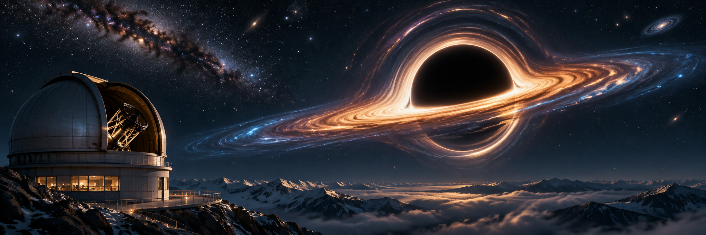
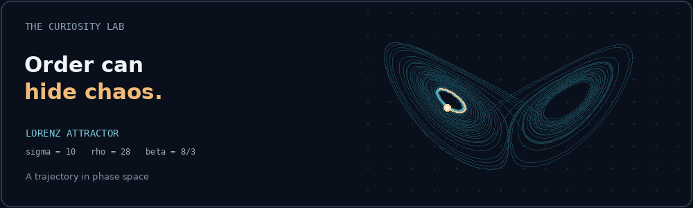

<h1 align="center">Hey, I'm Amirparsa 👋</h1>

  <strong>Curious about intelligence, complexity, and the universe.</strong> 
  AI · Cybersecurity · Systems · Science

I like big questions, small experiments, and ideas you can turn into code. This is my little corner of the internet for exploring how things work—and what happens when they don't work as expected.

---

## A little chaos 🦋

The image below follows a numerical solution of the **Lorenz equations**. The rules are deterministic; small differences in starting conditions can still lead to very different trajectories.

## Choose a rabbit hole 🔭

Click a question, take a guess, and open an interactive experiment from the open-source community.

<strong>🧠 Intelligence — Can 99% accuracy mean a model learned almost nothing?</strong>

Imagine that 99% of a dataset belongs to one class. A model that always predicts that class gets **99% accuracy**, yet never identifies the rare class. Good evaluation depends on the problem, the data, and the errors that matter.

**Try it:** [Train a neural network in TensorFlow Playground](https://playground.tensorflow.org/) · [Source](https://github.com/tensorflow/playground)

<strong>🌪️ Chaos — If the rules are deterministic, is the future always predictable?</strong>

Not necessarily. In a chaotic system, nearby starting states can diverge rapidly. When measurements have limited precision, long-term predictions can become unreliable even though the rules themselves are deterministic.

**Try it:** [Play with a double pendulum](https://www.myphysicslab.com/pendulum/double-pendulum-en.html) · [Source](https://github.com/myphysicslab/myphysicslab)

<strong>∞ Mathematics — How can a simple rule create endless detail?</strong>

Start with `z = 0`, repeatedly apply `z → z² + c`, and ask whether the sequence stays bounded. Exploring different values of `c` reveals the intricate boundary of the **Mandelbrot set**.

**Try it:** [Explore the Mandelbrot set](https://mandelbrot.page/) · [Source](https://github.com/davidbau/mandelbrot)

---

  <em>Keep questioning. Keep experimenting.</em> 
  <a href="https://www.researchgate.net/profile/Amirparsa-Rabiei">ResearchGate</a>

