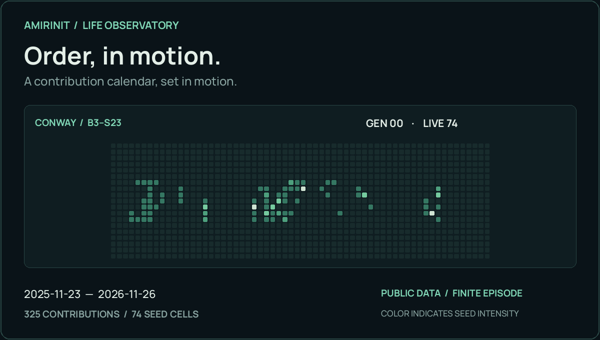

# AmirInit / Life Observatory

**Simple rules. Unscripted structure.**

<picture>
  <source media="(max-width: 600px)" srcset="assets/observatory-mobile.gif">
  
</picture>

Each day of public contribution activity becomes a living cell. Conway's B3/S23 rule then evolves that initial condition; the episode restarts so the origin remains visible. [Explore Emergence Lab →](https://amirinit.github.io/Amirinit/) · [Static view](assets/observatory.png) · [Method & source](docs/method.md)

I'm Amirparsa, a software engineering student interested in the meeting point of artificial intelligence, quantitative research, and computational systems. I explore intelligent agents, financial technology, cybersecurity, and Linux, drawn to the ways mathematics and careful engineering can make complex ideas useful. Open source and scientific curiosity shape how I learn and build.

### Beyond the Observatory

For a closer look at my research, projects, and background, visit my personal website.

**[Explore my website →](https://amirinit.github.io/)**
