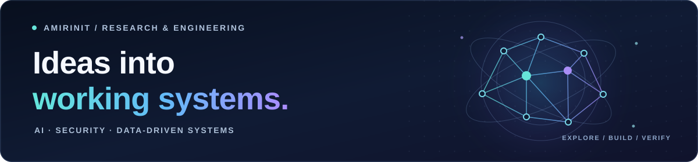

# Amirparsa Rabii

**Software Engineering · Artificial Intelligence · Cybersecurity**

I'm a software engineering student who enjoys exploring difficult questions and turning ideas into practical systems. My interests bring together AI research, security, Linux, and data-driven approaches to financial markets.

[ResearchGate](https://www.researchgate.net/profile/Amirparsa-Rabiei) · [Research papers](#selected-research) · [Public projects](#selected-public-work)

## Areas of interest

- **AI & research** — machine learning, Persian NLP, model evaluation, and intelligent agents.
- **Security & systems** — cybersecurity, networks, Linux, and tools for privacy and resilience.
- **Quantitative & financial systems** — market analysis, prediction markets, and automation.

## Selected research

- **[BERTCaps: BERT Capsule for Persian Multi-Domain Sentiment Analysis](https://arxiv.org/abs/2412.05591)**  
  Co-authored research on Persian sentiment analysis across domains. *arXiv preprint, 2024.*
- **[A survey of generative adversarial network on next generation network](https://www.researchgate.net/publication/391561422_A_survey_of_generative_adversarial_network_on_next_generation_network)**  
  Co-authored survey exploring GANs and next-generation networks. *ResearchGate manuscript, 2025.*

> My name appears as **Amir Parsa Rabiei** in these research records.

## Selected public work

- **[Rayan International AI Contest submissions](https://github.com/AmirInit/Rayan_ML_Contest_2024)** — code submissions from an AI competition, with a link to collected datasets.
- **[IP-based Kill Switch](https://github.com/AmirInit/Ip-based-killswitch-extention)** — a browser extension for domain access rules based on an IP allowlist.
- **[Auto-Windscribe](https://github.com/NullRoute-Lab/Auto-Windscribe)** — an unofficial Linux terminal interface for connection analysis and Windscribe CLI management.

## Background

- B.Sc. student in Software Engineering, Islamic Azad University of Hamedan.
- First place in the national **IRAN CTF** cybersecurity competition.
- Experience in SOC engineering and AI consulting.

## Tools I use and explore

`Python` · `Go` · `Bash` · `Linux` · `Git` · `Podman` · `Docker` · `Wireshark` · `FastAPI` · `PostgreSQL`

---

*Curious about the evidence behind an idea — and how to make it useful.*
